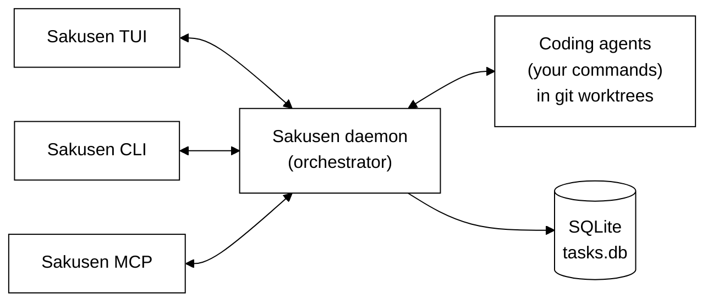

# 作戦

Sakusen is a daemon that orchestrates coding agents through long-lived, multi-step workflows. An agent is just a shell command you declare in config — [Claude Code](https://docs.anthropic.com/en/docs/claude-code), opencode, aider, a raw model CLI, anything — and Sakusen talks to it through a small environment-variable contract. Each task runs in its own git worktree on its own branch, advances through whatever steps you define in config — anything from a single "implement" step to a full plan/implement/review/approve/merge chain with loops and human gates — and reports back to a terminal UI where you stay in the driver's seat.

You decide what runs, how many run at once, where the human gates go, and how finished work lands on your base branch. Sakusen just keeps the agents on the rails.

> ⚠️ **Early days — breaking changes expected.** Sakusen is under active development. Config formats, CLI flags, and the database schema may change without notice between releases. Pin to a tagged version if you need stability.



## Why

- **You stay in control.** Human-approval gates pause any step until you sign off. Tmux steps drop you straight into the agent's session for back-and-forth.
- **Parallelism without conflicts.** Every task gets a dedicated git worktree and branch, so N agents can work concurrently on the same repo without stepping on each other.
- **Workflows, not one-shots.** Chain planning, implementation, review, and final-approval steps. Loop the review/implement cycle until it converges. Pass artifacts between steps.
- **It survives a reboot.** Tasks live in SQLite. Logs are persisted per step. Stop the daemon, restart it, pick up where you left off.
- **Local first.** No cloud, no telemetry. A Go binary, a Unix socket, a SQLite file under `~/.config/sakusen/`.

## Install

```bash
go install github.com/Bakaface/sakusen/cmd/sakusen@latest
```

Requires Go 1.25+. The binary lands in `$(go env GOBIN)` (defaults to `$(go env GOPATH)/bin`) — make sure that's on your `PATH`.

To pin to a specific release, replace `@latest` with a tag (e.g. `@v0.1.0`). To verify what you installed:

```bash
sakusen version
```

Building from a checkout works too:

```bash
git clone https://github.com/Bakaface/sakusen && cd sakusen
go build -o sakusen ./cmd/sakusen
```

### Claude Code plugins

The repo ships two Claude Code plugins:

- **`sakusen`** (`claude-code-plugin/`) — the Sakusen MCP server (`sakusen mcp`). Load it wherever agents route tasks to Sakusen.
- **`sakusen-skills`** (`claude-code-skills-plugin/`) — the sakusen-configurer, worktree-parity-audit and wayfinder-sakusen skills. Optional.

Load them from a checkout with `--plugin-dir`:

```bash
claude --plugin-dir <repo>/claude-code-plugin --plugin-dir <repo>/claude-code-skills-plugin
```

or add the repo's `sakusen-local` marketplace with `/plugin marketplace add <repo>` and install them with `/plugin install sakusen@sakusen-local` and `/plugin install sakusen-skills@sakusen-local`.

**Migrating from the single plugin.** Earlier versions bundled the skills inside `sakusen`. Existing installs keep the MCP server and its tool names (`mcp__plugin_sakusen_sakusen__*`) unchanged. To keep the skills, also load `sakusen-skills`. Namespaced skill references change from `sakusen:<skill>` to `sakusen-skills:<skill>`; bare skill names are unaffected. A session can now drop only the skills by disabling `sakusen-skills` (e.g. `"sakusen-skills@inline": false` in `.claude/settings.json` for `--plugin-dir` loads) while the MCP server stays on.

## Quick Start

```bash
# Inside any git repo:
sakusen init               # writes .sakusen.yml + user-owned agent scripts under .sakusen/agents/
sakusen daemon start       # starts the background daemon (Unix socket)
sakusen tui                # opens the TUI
```

The scaffolded config defines two Claude Code agent records (`claude` headless, `claude-tmux` interactive) backed by editable scripts in `.sakusen/agents/` (they require `claude` and `jq` on `PATH`). Swap the commands to use any other tool — Sakusen itself has no agent hardcoded.

In the TUI, press `n` to create a new task, pick a workflow, and watch it run. Press `enter` on a task to follow its live logs.

To run from the command line instead:

```bash
sakusen create "Add a /healthz endpoint"          # creates a pending task
sakusen start <id>                                # kicks off its workflow
sakusen logs <id>                                 # tails its logs
sakusen tasks                                     # list, or `sakusen tasks <id>` for detail
```

## How a task runs

1. **You create a task** (TUI or `sakusen create`) and pick a workflow.
2. **The daemon picks it up** when a worker slot is free (`max_workers` controls concurrency).
3. **A worktree is provisioned** at `.worktrees/<branch>` on a new branch derived from `git.branch_template`. `worktree-sync-paths` and `worktree-setup-commands` run here (e.g. copy `.env`, run `bun install`).
4. **Each workflow step spawns an agent** in that worktree: Sakusen resolves the step's agent record (step → workflow → `default_agent` → `claude`), writes the rendered prompt to a file, and runs the agent's shell command with the `SAKUSEN_*` env contract exported (`SAKUSEN_PROMPT_FILE`, `SAKUSEN_RESULT_FILE`, ...). Stdout is streamed to the unified task log and broadcast to the TUI.
5. **Step context is captured** at the end of each step (the agent's result text from `$SAKUSEN_RESULT_FILE` by default, or a summary produced by your `summarizer:` command when `summarization_strategy: summarize_chat`) and made available to later steps via `{{steps.<name>.context}}`.
6. **Human gates pause** the workflow on `human: true` steps; **tmux-mode agents** suspend the workflow at an interactive session until a turn-end sentinel lands or you advance manually. **Loops** jump back to an earlier step until an exit condition is met or `max_iterations` is reached.
7. **On completion**, depending on `on_complete` (project-level, or the running workflow's override), Sakusen either leaves the work as a `commit` on the branch or `merge`s it into the base branch. Child tasks a step spawns with `create_tasks_and_wait` merge into the base branch too, unless the child sets `merge_into_parent: true`: it then branches from the parent task's branch and fast-forwards the parent's worktree (once the parent is suspended and its worktree clean), so the children's work reaches main only through the parent's own later steps and merge.

## Workflow configuration

Workflows live in `.sakusen.yml` at the repo root as a flat `workflows:` list. Each entry is either a string ref (resolved to `.sakusen/workflows/<name>.yml`) or an inline workflow mapping.

A workflow may **pin** any subset of New Task screen fields (`input`, `worktree`, `branch`, `checkout`, `target`, `workdir`). Pinned fields are pre-filled and hidden from the form. `workdir` names a subdirectory of the task's checkout where every agent and tmux session starts (useful when a subdirectory carries its own `CLAUDE.md` / `.mcp.json` / `.claude/settings.json`); it is optional and never required for skipping the screen. If all other fields are pinned the New Task screen is skipped entirely and the task is created immediately. (A separate top-level `description:` is human-readable metadata — a one-line summary surfaced in the workflow picker and via MCP `list_workflows`; it is **not** a pin and never becomes the task input.)

Minimal `.sakusen.yml`:

```yaml
max_workers: 3

default_agent: claude
agents:
  claude:                         # any shell command; this one is Claude Code headless
    mode: headless
    command: 'claude --dangerously-skip-permissions -p "$(cat "$SAKUSEN_PROMPT_FILE")" | tee "$SAKUSEN_RESULT_FILE"'

git:
  base_branch: main
  branch_template: sakusen/{{task_id}}-{{task_slug}}
  verify_command: mise run check  # optional: must pass before on_complete: merge lands
  verify_timeout: 15m             # optional: limit per verify run (default 15m, 0 = no limit)
  verify_parent_merges: true      # optional (default true): false skips verify_command for merges
                                  # into a parent task's branch (fanout `merge: parent`, create_tasks_and_wait
                                  # `merge_into_parent`); the parent's own merge into the base is always verified
  # optional: writes the daemon's commit messages from the staged diff on stdin
  # (first non-empty stdout line; failure/timeout/empty → title-derived message)
  commit_message_command: >-
    claude -p --model haiku "Write a one-line conventional commit message, <type>(<scope>): <subject>, for the staged diff on stdin. Print only the message."
  commit_message_timeout: 2m      # optional: limit per message run (default 2m)

on_complete: merge                # commit | merge | none (per-workflow overridable)

workflows:
  - name: sensible workflow
    on_complete: commit           # optional: override the project-level on_complete
    steps:
      - name: implementing
        prompt: |
          Implement task #{{task.id}}: {{task.title}}
          {{task.input}}
        timeout: 30m

      - name: reviewing
        prompt: |
          Review the implementation.
          ## Implementation summary
          {{steps.implementing.context}}
        timeout: 20m
```

Workflows with no pins always prompt the New Task screen. Workflows that pin all fields (input + worktree + branch/checkout + target) skip the screen and create the task immediately — useful for predefined maintenance jobs or project bootstrapping pipelines:

```yaml
workflows:
  - name: housekeeping
    description: "Run standard maintenance: linting, dead code removal"   # metadata (picker/MCP)
    input: "Audit and clean the codebase: lint, remove dead code."        # pins the task input
    worktree: true
    branch: sakusen/housekeeping-{{task.id}}
    target: main
    steps:
      - name: cleaning
        prompt: "Audit and clean the codebase."
```

File pool is flat: `.sakusen/workflows/<name>.yml` (no `tasks/`, `one-off/`, or `init/` subdirectories). Global pool: `~/.sakusen/workflows/<name>.yml`.

### Routines

`workflows:` defines what to run. `routines:` — its sibling top-level key — defines *ways of running it*. A routine names a workflow, supplies pins, and optionally a trigger (`cadence` or `after`). It never defines steps.

```yaml
routines:
  - name: compose-wiki               # on-demand: run it by name, whenever
    description: Rebuild the wiki    # metadata (palette, MCP)
    workflow: wiki-compose           # the workflow it binds — required
    branch: sakusen/wiki-{{task.id}} # pins, overriding the workflow's own
    target: main

  - name: nightly-sweep              # same workflow, different binding + a schedule
    workflow: wiki-compose
    cadence: "0 3 * * *"             # 5-field cron, @daily/@hourly/..., or @every 90m
    priority: low
```

"Kind" is emergent rather than declared:

| Shape | How it starts |
|---|---|
| Workflow, no routine | New Task screen (`n`), or immediately if fully pinned |
| Workflow + routine | On demand: `:RunRoutine` in the TUI, `sakusen routines run <name>`, MCP `run_routine` |
| Workflow + routine + cadence | All of the above, plus the daemon fires it on schedule |
| Workflow + routine + after | All of the above, plus the daemon fires it each time the named routine's run completes |

One workflow can back any number of routines — which is the point: the pins live on the binding, not the definition.

**After.** `after: <routine>` names another routine in the same `.sakusen.yml`; this routine fires each time that routine's run reaches `completed` (a failed run is skipped). It is mutually exclusive with `cadence`; unknown names, self-references and cycles are config errors.

**Pin override.** A pin set on the routine wins over the workflow's, field by field (`input`, `worktree`, `target`, `workdir`). `branch` and `checkout` override as a *pair*: setting either on the routine ignores both of the workflow's, since they are two ways to answer the same question.

**Arguments.** A routine takes one optional free-text argument that becomes `{{task.input}}`:

```bash
sakusen routines run compose-wiki                 # uses the routine's own input:, if any
sakusen routines run digest "the security section"  # overrides it
```

If the bound workflow references `{{task.input}}` and neither the routine nor the workflow pins an input, the routine *requires* that argument — the TUI asks for it, the CLI and MCP reject an empty one. A **triggered** routine (`cadence` or `after`) in that state is a config error: an automatic fire has nobody to ask.

**Reachability.** A workflow listed in `workflows:` shows up in the `n` picker. A workflow file under `.sakusen/workflows/` that is *not* listed stays hidden — reachable by exact name only. Binding it from `routines:` is what makes it startable, so `sakusen validate` won't nag about it being hidden.

Routines are read-only at runtime: edit `.sakusen.yml` to add or change them. `sakusen routines` surfaces their schedule, pause state and run history:

```bash
sakusen routines list                 # NAME / CADENCE / WORKFLOW / NEXT FIRE / LAST FIRE / STATUS
sakusen routines show <name>
sakusen routines run <name> [input]   # run now; does not advance a schedule
sakusen routines runs <name>          # tasks this routine has created
sakusen routines pause|resume <name>  # triggered (cadence/after) routines only
```

### Step options

| Key | Type | Notes |
|---|---|---|
| `name` | string | Step ID, used in `{{steps.<name>.context}}` and loop targets. |
| `prompt` | string | Templated prompt sent to the agent. |
| `agent` | string | Agent slug for this step. Step-level overrides workflow-level `agent:`, which overrides `default_agent:`. The agent's `mode` (headless/tmux) decides how the step executes. |
| `timeout` | duration | e.g. `30m`. Default: 30 minutes. |
| `human` | bool | Pause and wait for explicit approval in the TUI. |
| `summarization_strategy` | enum | `last_message`, `summarize_chat` (default; runs your `summarizer:` command over the chat log), or `none` (no context captured). |
| `loop` | object | Jump back to an earlier step, or repeat this one. See below. |
| `fanout` | object | Spawn one child task per item an earlier step published (`from:`), or per node of a declared `nodes:` graph, then join on them. Replaces `prompt`/`agent`. See [Fan-out steps](#fan-out-steps). |

### Loops

```yaml
- name: reviewing
  prompt: |
    Review iteration {{loop.iteration}} of {{loop.max_iterations}}.
    {{steps.implementing.context}}
    If everything passes, output nothing.
  loop:
    goto: implementing
    max_iterations: 3
    exit_condition:
      step_context_empty: reviewing   # exit early when this step's output is empty
```

`exit_condition` accepts three forms; the loop exits as soon as any configured one matches:

- `step_context_empty: <step>` — exit when that step's context is empty.
- `step_context_contains: <step>` + `marker: <literal>` — exit when that step's context contains the marker.
- `command: <shell string>` — let a program decide. It runs via `bash -c` in the task's workdir with the step env (`SAKUSEN_TASK_ID`, `SAKUSEN_STEP`, `SAKUSEN_LOOP_ITERATION`, …, `SAKUSEN_PURPOSE=loop_exit`). Optional `stdin_from: <step>` pipes that step's context to stdin, and `timeout:` (Go duration, default `2m`) bounds it. Exit `0` ends the loop, `1` continues it; any other status, a timeout or a failure to start fails the task, with the command's output in the failure reason. The tail of the command's output goes to the task log on every outcome.

```yaml
    exit_condition:
      command: 'test "$(grep -rl old_api src | wc -l)" -eq 0'
```

Prefer an affirmative form (`step_context_contains` or `command`): `step_context_empty` cannot tell "done" from "the step crashed or published nothing".

`on_max_iterations` decides what happens when the loop reaches `max_iterations` without its exit condition matching. `continue` (the default) ends the loop and moves on to the next step. `fail` still evaluates the exit conditions on that last pass and fails the task if none matches (`loop on step "<step>" reached max_iterations (N) without meeting its exit condition`). `fail` requires an `exit_condition`. Use `fail` for autonomous loops in workflows that auto-merge (`on_complete: merge`), so an unfinished loop is never reviewed and merged as if it were done:

```yaml
    loop:
      goto: batch
      max_iterations: 30
      on_max_iterations: fail
      exit_condition:
        command: roomba-gate
        stdin_from: inventory
```

`goto` may name an earlier step or the loop step itself; a self-loop (`goto: batch` on the `batch` step) repeats that one step until its exit condition holds. Loops can't jump forward, can't be `human:` or resolve to a tmux-mode agent, and can't overlap with or nest inside other loops.

### Fan-out steps

A `fanout:` step runs no agent. It spawns one child task per item that an earlier step published, waits for all of them, then advances to the next step. That step reads every child's result through the fanout's aggregate context.

```yaml
- name: inventory
  agent: planner            # publishes items via the publish_items MCP tool
- name: units
  fanout:
    from: inventory         # earlier step whose published items drive this fan-out
    workflow: fast-and-furious
    input: "{{steps.inventory.context}}\n\nYour unit:\n{{item.input}}"
    merge: parent           # children base on and merge into this task's branch
    require: all            # all | any | N
    retries: 1              # automatic re-runs of a failed child before the join judges it
- name: finishing
  prompt: |
    The units are done:
    {{steps.units.context}}
```

| Key | Default | Notes |
|---|---|---|
| `from` | required unless `nodes` is set | An earlier, ordinary top-level step (not a fanout, parallel group or parallel branch). It publishes the items. |
| `workflow` | required (with `nodes:`, unless every node sets its own) | The workflow each child runs. It must exist and have no `human:` step or step that resolves to a tmux-mode agent, because children run unattended. |
| `input` | `{{item.input}}` | Child task input template. Sees the normal variables plus `{{item.*}}`. Rejected with `nodes:`, where each node carries its own. |
| `merge` | `base` | `parent`: children base on and merge into the fanning-out task's branch. `base`: children target the usual base branch. |
| `require` | `all` | Join policy: `all`, `any`, or an integer `N >= 1` (at least N children must complete). |
| `retries` | `0` | How many times a failed child is re-run automatically before the join judges it. |
| `allow_empty` | `false` | Only valid with `from`. When `true`, a `from:` step that publishes nothing does not fail the task: the fanout spawns nothing, skips `require` and completes at once. Rejected with `nodes:`. |

A fanout step cannot set `prompt`, `agent`, `loop`, `human`, `advance`, `parallel`, `summarization_strategy`, `summarization_prompt` or `require_context`. No loop's `goto` range may contain a fanout step, because re-running it would spawn its children again. Config loading and `sakusen validate` reject every one of these.

**Publishing items.** The `from:` step's agent calls the `publish_items` MCP tool, or runs `sakusen publish-items`. The task and step default to `$SAKUSEN_TASK_ID` / `$SAKUSEN_STEP`. Each item is `{input, slug?, title?, needs?}`:

- `input` is required and non-empty.
- `slug` must match `^[A-Za-z0-9][A-Za-z0-9._-]{0,63}$` and be unique. A missing slug becomes `item-<n>` (1-based position).
- `needs` lists slugs of other items whose children must complete first. It becomes the child's `blocked_by`. Unknown slugs, self-references and cycles are rejected.

The call is validated at once and errors go back to the model. The step must be running, and a later fanout must name it in `from:`. Publishing again replaces the list. Every fresh run of the `from:` step clears its earlier list. A headless `from:` step that completes without publishing fails the task. A tmux one that publishes nothing fails at the fanout instead. With `allow_empty: true`, neither fails: the fanout spawns nothing, does not apply `require`, and advances with `{{steps.<fanout>.context}}` set to `fanout <name>: 0 items published (allow_empty)`. If items were published, `allow_empty` changes nothing.

**Spawn.** On entry the fanout creates one child per item in the parent's project, in dependency order:

- each child gets the rendered `input`, the parent's track and priority, and a title (the item's `title`, or its slug if it has none);
- `needs` become `blocked_by` edges between the children;
- the parent then sits in `awaiting-children`.

A `require: N` larger than the number of items fails the step before anything spawns. Each child records its parent, fanout step and item. A unique index on those three keeps spawning idempotent across a daemon restart.

**Join.** The parent resumes once every child is terminal:

- A failed child is re-run while it has retries left. Dependents that were cascade-failed by a retried blocker never ran, so they are reset alongside it without spending their own attempts.
- `require` is then applied. If it is met, the aggregate becomes `{{steps.<fanout>.context}}` and the task advances to the next step; the fanout step itself is not re-run. If not, the task fails with an error listing the failed items as `<slug> #<child id>`.
- Retrying the parent reuses completed children and re-runs failed ones, with their attempt counters reset.

**Depth cap.** A child workflow may itself fan out, down to `MaxFanoutDepth` = 3 levels. A task already at that depth fails its fanout step at spawn time.

**Aggregate context.** One header line, then one line per item in published order:

```
fanout units: 2/3 completed (require all)
- api #12 completed — Added the endpoint and its tests
- ui #13 completed — (no context)
- docs #14 failed — (failed: step "write" exited with code 1)
```

Each summary is the first non-empty line of the child's context with whitespace collapsed, truncated to 120 runes (ending in `…`), and further when needed so no item line exceeds 200 runes. Children with no context show `(no context)`. A failed child shows `(failed: <first line of its error>)`. This keeps the aggregate compact at hundreds of children. Full per-child results stay reachable via `get_task` on the listed IDs, or via `{{tasks.<id>.context}}`.

#### Declared nodes

When the units are known when you write the workflow, declare them under `nodes:` instead of publishing them at run time. `needs:` orders them as a graph:

```yaml
- name: planning
  prompt: Plan the change for {{task.input}}.
- name: build
  fanout:
    workflow: fast-and-furious   # default for every node
    merge: parent
    retries: 1                   # default for every node
    nodes:
      - name: schema
        input: "Design the schema.\n\n{{steps.planning.context}}"
      - name: api
        input: "Build the API on this schema:\n{{steps.schema.context}}"
        needs: [schema]
      - name: ui
        input: "Build the UI on this schema:\n{{steps.schema.context}}"
        needs: [schema]
        retries: 2
      - name: e2e
        workflow: test-only
        input: "Write end-to-end tests.\n{{steps.api.context}}\n{{steps.ui.context}}"
        needs: [api, ui]
- name: finishing
  prompt: |
    {{steps.build.context}}
```

| Key | Default | Notes |
|---|---|---|
| `name` | required | Node name. It must match the item slug shape (`^[A-Za-z0-9][A-Za-z0-9._-]{0,63}$`). |
| `workflow` | the step's `workflow` | The workflow this node's child runs. |
| `input` | required | Child task input template. |
| `needs` | none | Names of sibling nodes that must complete first. |
| `retries` | the step's `retries` | Automatic re-runs of this node's failed child. |

Rules, checked at config load and by `sakusen validate`:

- `from:` and `nodes:` are mutually exclusive, and the step-level `input:` is rejected with `nodes:` (each node carries its own).
- Node names join the workflow's step namespace, so they must not collide with any step, parallel branch or other node. A node's context is addressable as `{{steps.<node>.context}}`.
- `needs` may only name nodes of the same fanout, and cycles are rejected.
- A node's `input` may reference `{{steps.<name>.context}}` only for its transitive needs or for names declared before the fanout.
- A node that another node needs must run a child workflow with `on_complete: merge`, because its dependents build on its merged work.
- A `require: N` larger than the node count is rejected.
- In a node's input, `{{item.slug}}` and `{{item.title}}` are the node name, `{{item.index}}` is its 1-based position in `nodes:`, and `{{item.input}}` is empty.

At run time:

- A node's child is spawned only once all its needs have completed (merged), and its input is rendered at that moment. With `merge: parent`, the node's worktree therefore already holds its needs' work. Nodes get no `blocked_by` edges; the engine holds them back itself.
- Each node is retried on its own `retries`.
- A node whose need failed for good is never spawned. It counts as failed at the join and shows as `- <node> (skipped: need <need> failed)` in the aggregate.
- Each completed node gets its own step row, so later steps read `{{steps.<node>.context}}` as well as the fanout's aggregate.
- The parent wakes whenever any child becomes terminal, so ready nodes start without waiting for unrelated siblings.
- The TUI lists the node rows in dependency order.

**`parallel:` or `fanout:`?** Use a shared `parallel:` group for branches with inline prompts that only read, on the task's own worktree (for example, several reviewers of one diff). Use `fanout:` when each unit writes code: every child is an isolated task with its own worktree, workflow, retries and merge.

### Template variables

Available in any step `prompt`:

- `{{task.id}}`, `{{task.title}}`, `{{task.input}}`, `{{task.context}}`, `{{task.slug}}`, `{{task.branch}}`
  — `task.input` is the user-supplied task input; `task.context` is the summary written by the workflow's summarizer after the task completes; empty until then.
- `{{tasks.<id>.<field>}}` — reference another task's field by ID. Supported fields: `title`, `branch`, `input`, `context`.
  References inside the task's own `input`/`context` are pre-expanded before being inlined into a step prompt
  (single-pass; nested refs in the looked-up task's fields remain verbatim).
  At create or edit time, references are validated:
  - missing task, cross-project, failed dependency, or unsupported field → request is rejected;
  - active dependency → added automatically to `blocked_by`;
  - completed dependency → no edge added (its fields are already resolvable);
  - self-reference → resolved at runtime, but never added as a `blocked_by` edge.
  `{{tasks.<id>.context}}` is only populated after the referenced task has been summarized.
- `{{git.base_branch}}`
- `{{steps.<step_name>.context}}` — captured output of a prior step
- `{{loop.iteration}}`, `{{loop.max_iterations}}` (inside a loop body)
- `{{item.input}}`, `{{item.slug}}`, `{{item.title}}`, `{{item.index}}` (1-based) — the published item a
  child is spawned for. Available only in a fanout step's `input:`.
- `{{prompt.<name>}}` — inlines the contents of a shared prompt file, so several workflows can reuse
  one passage of text (craft guidance, review rules, commit hygiene) without duplicating it.
  `<name>` is a file basename (`[A-Za-z0-9_-]+`, kebab-case by convention) resolved to `<name>.md`,
  searched project-first:
  1. `<project>/.sakusen/prompts/<name>.md`
  2. `~/.sakusen/prompts/<name>.md`

  The file's contents are substituted first and the combined text resolved in the same pass, so an
  included passage may itself use `{{task.id}}` and friends. Includes are one level deep — an
  included file may not contain `{{prompt.*}}`. A single trailing newline is stripped so inline
  placement adds no blank line. Unlike other placeholders, an include that can't be resolved is
  never left verbatim: a missing file, a malformed name, or a nested include fails config loading
  and `sakusen validate` (naming the workflow, step, field and searched paths).

  Works in step `prompt`, step `summarization_prompt`, workflow `summarizer_prompt`, and
  `merge_conflicts.prompt`.

### Worktree provisioning

```yaml
worktree-sync-paths:
  copy: [".env", ".env.local"]      # copied into each worktree
  link: [".claude", "node_modules"] # symlinked

worktree-setup-commands:            # run sequentially after sync
  - bun install
  - bun run db:migrate

tmux-setup-command: |               # run once after tmux session creation
  tmux split-window -h "tail -f .sakusen/logs/<id>/<step>.log"
```

## Project layout reset


```
cmd/sakusen/         CLI entry points (daemon, tui, task CRUD)
internal/
  config/           .sakusen.yml parsing, agent registry, project type auto-detection
  daemon/           Background daemon: Unix socket server, scheduling, pub/sub
  workflow/         Step engine, prompt templating, summarizer, merge logic
  runner/           Agent command spawning (headless Process, RunSync, tmux wrapper scripts)
  agent/            Agent state machine, concurrent worker manager
  task/             Task model, status state machine, priority, dependencies
  tui/              BubbleTea terminal UI (list, detail, prompt, animation)
  db/               SQLite persistence and migrations
  git/              Worktree, branch, merge, conflict-resolution operations
  tmux/             Tmux session lifecycle, capture, monitoring
  client/           IPC client (RPC + event subscription) for tui/cli
  notify/           Desktop notifications
claude-code-plugin/ Claude Code plugin `sakusen` (the Sakusen MCP server only)
claude-code-skills-plugin/
                    Claude Code plugin `sakusen-skills` (skills: sakusen-configurer,
                    worktree-parity-audit, wayfinder-sakusen)
```

The daemon listens on a Unix socket at `~/.config/sakusen/daemon.sock` (or `$XDG_CONFIG_HOME/sakusen/`) and persists state to `tasks.db` next to it. Project-level data (logs, the `.worktrees/` directory) lives under `.sakusen/` inside the repo.

## TUI

Launch with `sakusen tui`. Add `-g` / `--global` to see tasks across every project Sakusen has tracked.

Common keys (full help with `ctrl+h`):

| Key | Action |
|---|---|
| `j` / `k` / `↑↓` | Move selection |
| `enter` | Open task detail / follow live logs |
| `n` / `N` | New task / new blocking task |
| `c` | Continue an awaiting-approval / completed / failed task |
| `s` | Stop the running step |
| `r` / `R` | Retry / revert |
| `M` | Retry only the merge of a `merge-failed` task (verify → merge → summarize → cleanup, no agent step re-runs) |
| `t` | Attach to the task's tmux session |
| `b` / `alt+b` | Branch a new task off this one / toggle branch tree view |
| `D` / `A` | Detach branch from worktree / reattach |
| `o` / `e` | Open / edit step context (artifact) |
| `dd` | Delete task (worktree + branch + logs) |
| `/`, `?`, `n`, `N` | Vim-style search and next/prev match |
| `gg`, `G`, `:N` | Jump to top, bottom, or line N |

In the detail view, `j/k/G/gg/ctrl+u/ctrl+d` scroll logs; `esc` toggles between follow and normal mode; `e` opens the log file in `$EDITOR`.

## Agents

Every workflow step runs an **agent**: a shell command declared under the top-level `agents:` map. Steps pick one via `agent: <slug>` (step-level beats workflow-level beats `default_agent:`, which falls back to the `claude` slug). The agent record's `mode` decides how the step executes:

- **`headless`** (default) — Sakusen spawns the command, streams its stdout to the task log, and reads the final result text from `$SAKUSEN_RESULT_FILE` when it exits.
- **`tmux`** — Sakusen runs the command inside a detached tmux session (`<project>-<task_id>`); the workflow pauses at the interactive session.

```yaml
default_agent: claude

agents:
  claude:
    mode: headless
    command: '"$SAKUSEN_PROJECT_PATH/.sakusen/agents/claude-headless.sh"'
  claude-tmux:
    mode: tmux
    command: '"$SAKUSEN_PROJECT_PATH/.sakusen/agents/claude-tmux.sh"'
    resume_command: 'claude --dangerously-skip-permissions --resume "$SAKUSEN_SESSION_ID"'
    chat_log_command: '"$SAKUSEN_PROJECT_PATH/.sakusen/agents/claude-chat-log.sh"'

summarizer:                 # utility LLM: chat/step/task summaries + AI task titles and slugs
  agent: claude:haiku       # a headless slug from `agents:` (variants/aliases work)
  max_prompt_bytes: 380000
  # command: ...            # alternative to agent:; the two are mutually exclusive
  # title_prompt: ...       # optional overrides of the built-in prompts;
  # slug_prompt: ...        # {{input}} is replaced with the task input
  # slug_agent: ...         # optional; runs the slug call on its own agent
  # slug_command: ...       # optional; runs the slug call on its own command
```

### System roles

Two jobs are not workflow steps but still need an agent: the **summarizer** and the
**merge-conflict resolver**. Each has its own top-level block holding the role's own knobs
(prompts, timeout, chunking) and picking a runner from the `agents:` registry — the registry
only says HOW something runs. Both roles run synchronous passes, so the agent must be
`headless` and must honor the file contract (`$SAKUSEN_PROMPT_FILE` in, `$SAKUSEN_RESULT_FILE`
out, with the stdout tail as a crude fallback).

```yaml
merge_conflicts:
  agent: codex              # optional; omit → the workflow's agent → default_agent → claude
  timeout: 10m              # optional; this is the default
  prompt: |                 # optional; replaces the built-in prompt body entirely
    Resolve the conflict markers left by merging `{{git.base_branch}}` into `{{task.branch}}`:

    {{conflict.files}}

    Stage each resolved file with `git add`. Do not commit.
```

`{{conflict.files}}` renders the conflicted files as one `` - `path` `` line each; task and git
variables resolve as usual, while step, loop, children and track variables resolve empty (no
step ran). `summarizer.agent`/`slug_agent` name registry slugs the same way, and the summarizer
keeps `command:`/`slug_command:` as the bare-command alternative (prompt on stdin, answer on
stdout) — `agent:` and `command:` are mutually exclusive.

Both blocks merge **wholesale** across config tiers: a `merge_conflicts:` or `summarizer:` block
in `.sakusen.yml` replaces the one from `~/.sakusen.yml` entirely rather than merging field by
field.

Sakusen communicates with agents purely through environment variables: `SAKUSEN_PROMPT_FILE` (the fully-resolved step prompt), `SAKUSEN_RESULT_FILE` (headless result text), `SAKUSEN_DONE_DIR`/`SAKUSEN_DONE_PREFIX` (tmux turn-end sentinels), plus `SAKUSEN_TASK_ID`, `SAKUSEN_STEP`, `SAKUSEN_WORKTREE`, `SAKUSEN_PROJECT_PATH`, `SAKUSEN_AGENT`, and `SAKUSEN_PURPOSE`.

**Tmux auto-advance is sentinel-driven**: when the agent finishes a turn, something inside the session (a hook, the agent itself, an idle-watcher) writes `"$SAKUSEN_DONE_DIR/$SAKUSEN_DONE_PREFIX-$(date +%s%N).json"`; the daemon polls for these files and advances the workflow (unless the step has `human: true`). The file may carry a JSON payload with `session_id` (enables `resume_command` restore and `chat_log_command` lookup) and `transcript_path`. The scaffolded `claude-tmux` agent wires this up via a Claude Code `Stop` hook; agents that never write a sentinel are **manual-advance** — the task waits in `tmux` status until you advance it. Agents without a `chat_log_command` can't capture `summarize_chat` context for tmux steps. Without a `summarizer:` there are no AI titles, slugs, or summaries (titles fall back to truncated input, slugs to the slugified title).

| agent `mode` | `human` | Behavior |
|---|---|---|
| headless (default) | false | headless spawn + auto-advance on exit |
| headless | true | headless spawn, then pause at `awaiting_approval` |
| tmux | false | tmux + auto-advance on turn-end sentinel (manual-advance if the agent writes none) |
| tmux | true | tmux + manual approval (drop into the session, then press `a`/`c`) |

Press `t` in the TUI to attach to a tmux session. Sakusen detects nested-tmux situations (you're already inside tmux) and either switches client or nests a session, controlled by `tmux_nested_attach_behavior` (`switch` / `nest`).

`sakusen attach <task_id>` does the same from the shell.

### Migrating from `claude:` / `yolo:` / `print:` configs

The old Claude-specific keys were removed and are now hard load errors with migration messages:

- `claude:` (binary override) → define agents under `agents:` (run `sakusen init` in a fresh project for scaffolded records)
- `yolo:` → put permission flags (e.g. `--dangerously-skip-permissions`) directly in the agent's `command`
- `system_prompt:` → bake system-prompt flags into the agent's `command` or fold the text into step prompts
- `allowed_summarization_models:` → the `summarizer:` block; pick the model inside its agent or command
- `merge_conflict_agent:` → `agent:` inside the top-level `merge_conflicts:` block
- `print:` / `tmux:` (workflow and step level) → select an agent whose `mode` is `headless` (was `print: true`) or `tmux` (was `print: false`)
- `{{claude_command}}` in `tmux-setup-command` → `{{agent_command}}` or `{{run_agent}}`

## CLI reference

**Daemon**

```bash
sakusen daemon start           # start (foreground; background it with '&' or your service manager)
sakusen daemon stop            # graceful shutdown
sakusen daemon status          # is it running, what PID
```

**Tasks**

```bash
sakusen create <input> [--workflow w] [--priority high] [--title T]
              [--branch tmpl] [--target main] [--checkout existing-branch]
              [--no-worktree]
sakusen tasks [<id>] [--json]  # list, or detail for one
sakusen edit <id> [--title T] [--input I] [--context C] [--priority P]
sakusen delete <id> [-y]
sakusen start <id>             # manually kick off a pending task
sakusen stop <id>              # stop a running task
sakusen retry <id> [--from-step name]  # restart workflow (default) or jump to a specific step
sakusen retry-merge <id>       # re-run only finalization (verify, merge, summarize, cleanup) of a merge-failed task
sakusen revert <id>            # revert all commits made by a completed task
sakusen continue <id>          # resume an awaiting-approval / completed / failed task
sakusen logs <id> [step] [-n N]
sakusen cleanup [<id>]         # remove worktree + branch + logs for completed/failed
sakusen agents [--json]        # list running agents
sakusen depends-on add <id> <blocked-by-id>     # mark <id> as blocked by another task
sakusen depends-on rm  <id> <blocked-by-id>     # remove a dependency
sakusen depends-on list <id>                    # list tasks blocking <id>
sakusen publish-items [--task N] [--step S] [--file F|-]  # publish fanout items (JSON array; defaults to $SAKUSEN_TASK_ID/$SAKUSEN_STEP, stdin)
```

**Routines**

```bash
sakusen routines list                 # routines declared under routines: in .sakusen.yml
sakusen routines show <name>
sakusen routines run <name> [input]   # run now (does not advance a schedule)
sakusen routines runs <name>          # tasks this routine has created
sakusen routines pause <name>         # triggered (cadence/after) routines only
sakusen routines resume <name>
sakusen tasks --routine-id N          # tasks created by a routine, by its DB id
```

**Worktree branch management**

```bash
sakusen detach <id>            # detach branch so you can check it out elsewhere
sakusen attach-branch <id>     # reattach after detach
sakusen attach <id>            # attach to the task's tmux session
```

**TUI**

```bash
sakusen tui [-g]               # -g for cross-project view
```

## Requirements

- Go 1.25+
- git (worktree support, ≥ 2.5)
- Whatever your configured agent commands need — the `sakusen init` scaffold uses the [Claude Code](https://docs.anthropic.com/en/docs/claude-code) CLI (`claude`) and `jq`
- tmux (only required if you use tmux-mode agents or `sakusen attach`)
